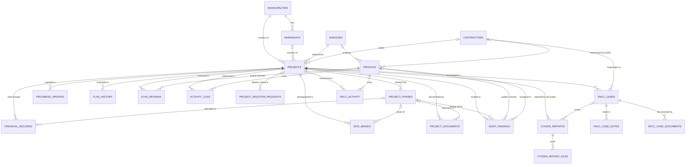

# Database

The database is PostgreSQL 17, hosted by Supabase (project **IPMATS**). This page was written from the live
database on 22 November 2026, not only from the migration files, and updated on 25 November 2026 for migrations
019 and 020. The PACC parts (migrations 023–026) and the project deletion requests (027), all applied 27 November 2026, are written from the migration files, as are the contractor accounts (028, applied 27 November 2026; 029, not yet applied: it is applied at merge time of PR #15, right before that PR's API is deployed).
Where the two differ, the live schema wins.

- What each table is used for in the app: [features.md](features.md)
- Who may read or change each table: [roles-and-permissions.md](roles-and-permissions.md)

## Overview

- **24 tables** in the `public` schema (6 of them for the PACC portal, 024; `project_pacc_status` from 029), plus one helper table in the `private` schema.
- **2 views** that join projects with their place, office, contractor and totals.
- **7 enum types** and several text columns limited by `CHECK` rules.
- **6 private storage buckets** for files (photos, evidence, documents, citizen report proof, PACC case documents).
- Row Level Security (RLS) is **on for every table**. All policies only allow reading. Every insert, update and
  delete is done by the Node.js API with the service-role key, after the API has checked the user's role.

## Entity-relationship diagram

The diagram shows the business entities only. The "who did it" links to `profiles` (created by, uploaded by,
reviewed by…) are listed in [Foreign keys](#foreign-keys-and-what-they-mean) instead, so the diagram stays readable.

`SYSTEM_SETTINGS` has no relationship to other tables except `updated_by → profiles`.

## Tables

Notation: **Null** = whether the column may be empty. "—" in Default means no default.
`timestamptz` = date and time with time zone. `jsonb` = structured data (JSON).

### municipalities
The 11 municipalities of Occidental Mindoro. A fixed lookup list, loaded by the seed.

| Column | Type | Null | Default | Description |
|---|---|---|---|---|
| id | smallint | no | — | Primary key |
| name | text | no | — | Municipality name (unique) |
| is_capital | boolean | no | false | True for the provincial capital |
| latitude | numeric | no | — | Centre point, used to pre-fill a project's location |
| longitude | numeric | no | — | Centre point |
| created_at | timestamptz | no | now() | When the row was added |

### barangays
Barangays of each municipality. A lookup list.

| Column | Type | Null | Default | Description |
|---|---|---|---|---|
| id | integer | no | — | Primary key |
| municipality_id | smallint | no | — | Municipality it belongs to. Name is unique within a municipality |
| name | text | no | — | Barangay name |
| latitude | numeric | yes | — | Centre point, if known |
| longitude | numeric | yes | — | Centre point, if known |
| created_at | timestamptz | no | now() | When the row was added |

### agencies
Implementing offices ("Offices & Agencies" in the app), for example a District Engineering Office.

| Column | Type | Null | Default | Description |
|---|---|---|---|---|
| id | smallint | no | — | Primary key |
| code | text | no | — | Short code, e.g. `DPWH-OMDEO` (unique) |
| name | text | no | — | Full office name |
| office_type | text | no | — | `district_engineering_office`, `field_office` or `other` |
| address | text | yes | — | Office address |
| created_at | timestamptz | no | now() | When the row was added |
| updated_at | timestamptz | no | now() | Last change (set by a trigger) |
| is_active | boolean | no | true | False = suspended: not offered for new projects; existing links stay |

### profiles
One row per user account. Linked one-to-one to the Supabase Auth user (`auth.users`).

| Column | Type | Null | Default | Description |
|---|---|---|---|---|
| id | uuid | no | — | Same id as the Auth user. Deleting the Auth user deletes the profile |
| email | text | no | — | Sign-in email |
| full_name | text | no | `''` | Display name |
| role | user_role | yes | — | Staff role, `pacc` or `contractor` (029). **Empty until the account is approved** |
| agency_id | smallint | yes | — | Office the person works for |
| position | text | yes | — | Job title |
| is_active | boolean | no | true | False = deactivated or suspended; the API refuses every request |
| requested_role | user_role | yes | — | Role asked for at registration (`dpwh_personnel`, `auditor` or, 029, `contractor` only) |
| approval_status | text | no | `'approved'` | `pending`, `approved` or `rejected`. Self-registered accounts get `pending` or `rejected` from the sign-up trigger, not this default |
| requested_at | timestamptz | yes | — | When the access request was made |
| reviewed_by | uuid | yes | — | Administrator who approved or declined |
| reviewed_at | timestamptz | yes | — | When it was reviewed |
| review_note | text | yes | — | Reason given when declining |
| avatar_path | text | yes | — | Profile photo file in the `avatars` bucket |
| created_at | timestamptz | no | now() | When the account was created |
| updated_at | timestamptz | no | now() | Last change (trigger) |
| suspended_at | timestamptz | yes | — | When the account was suspended |
| suspended_by | uuid | yes | — | Administrator who suspended it |
| suspension_reason | text | yes | — | Required reason, 5–500 characters |
| contractor_id | uuid | yes | — | The contractor company a `contractor` account represents (029). Required for that role; empty for every other role. One company can have several accounts |
| requested_contractor_id | uuid | yes | — | Company chosen at registration by a "Contractor representative" (029; must exist, else the request is declined by the sign-up trigger). The Admin confirms or corrects it on approval |
| requested_contractor_license | text | yes | — | PCAB licence number typed at registration, at most 50 characters (029). User Management shows whether it matches the company's licence (ignoring case and spaces) |

Rules: a role can only be set when `approval_status = 'approved'` (`profiles_role_requires_approval`). A `contractor` account must have a company (`profiles_contractor_has_company`: `role is distinct from 'contractor' or contractor_id is not null`, 029).

### contractors
Construction contractors and their PCAB licence.

| Column | Type | Null | Default | Description |
|---|---|---|---|---|
| id | uuid | no | gen_random_uuid() | Primary key |
| name | text | no | — | Company name (unique) |
| pcab_license_no | text | yes | — | PCAB licence number (unique) |
| classification | text | yes | — | PCAB classification |
| address | text | yes | — | Business address |
| contact_person | text | yes | — | Contact person |
| contact_number | text | yes | — | Phone number |
| email | text | yes | — | Email |
| is_active | boolean | no | true | False = suspended / inactive |
| created_by | uuid | yes | — | Who added it |
| created_at | timestamptz | no | now() | When it was added |
| updated_at | timestamptz | no | now() | Last change (trigger) |

### projects
The infrastructure projects: the centre of the system.

| Column | Type | Null | Default | Description |
|---|---|---|---|---|
| id | uuid | no | gen_random_uuid() | Primary key |
| project_code | text | no | — | Project ID, e.g. `26OM0332`. **Assigned by the database** on insert and cannot be changed |
| name | text | no | — | Project title |
| description | text | yes | — | Scope of work |
| project_type | project_type | no | — | Road, bridge, flood control… |
| agency_id | smallint | no | — | Implementing office |
| contractor_id | uuid | yes | — | Contractor; empty = not yet awarded |
| contract_ref_no | text | yes | — | Contract reference number (staff only) |
| municipality_id | smallint | no | — | Municipality |
| barangay_id | integer | yes | — | Barangay |
| latitude | numeric | no | — | Site location; must be 12.0–14.05 |
| longitude | numeric | no | — | Site location; must be 119.85–121.3 |
| approved_budget | numeric | no | — | Approved Budget for the Contract (ABC), ≥ 0 |
| contract_amount | numeric | yes | — | Awarded contract amount, ≥ 0 |
| notice_to_proceed | date | yes | — | Notice to Proceed (NTP) date = start of works |
| duration_days | integer | yes | — | Contract duration in calendar days, > 0 |
| target_completion_date | date | yes | — | NTP + duration (computed by the API if not given); not before the NTP |
| actual_completion_date | date | yes | — | Date the works finished; not before the NTP |
| fund_source | text | yes | — | Source of funds (staff only) |
| status | project_status | no | `'not_started'` | Lifecycle status, set automatically (see [workflows](workflows.md#project-lifecycle)) |
| created_by | uuid | yes | — | Who registered it |
| updated_by | uuid | yes | — | Who changed it last |
| created_at | timestamptz | no | now() | When it was registered |
| updated_at | timestamptz | no | now() | Last change (trigger; a change to only the PACC status columns does not count, 027) |
| overall_progress | numeric | no | 0 | Physical progress 0–100 % (weighted phase accomplishment) |
| completion_status | completion_status | no | `'not_completed'` | Completed only when every completion requirement is met |
| planned_progress | numeric | no | 0 | Where the schedule says the project should be today, 0–100 % |
| auto_flag | flag_color | yes | — | Latest automatic flag |
| auto_flag_reasons | jsonb | no | `'[]'` | The reasons behind the automatic flag |
| auto_flag_evaluated_at | timestamptz | yes | — | When the automatic check last ran |
| current_flag | flag_color | yes | — | The flag users see: automatic, or the auditor's decision |
| flag_review_status | flag_review_status | no | `'pending'` | Whether an auditor confirmed or overrode the current flag |
| reviewed_flag | flag_color | yes | — | The auditor's last decision. The flag shown never drops below it automatically |
| public_flag | flag_color | yes | generated | Flag shown on the public portal: `current_flag` when `flag_review_status` is `confirmed` or `overridden`, otherwise null ("Under review"). Generated by the database (021); the only flag column anon may read |
| audit_status | audit_status | no | `'not_audited'` | Audit progress of the project |
| pacc_public_status | text | yes | — | PACC case status shown on the public portal: `under_investigation` or `case_filed` when the project's non-closed case has "show to public" on, otherwise null. Kept by a trigger on `pacc_cases` (024), never written directly; anon may read it |

### project_phases
Construction phases of a project (weights of one project total 100 %).

| Column | Type | Null | Default | Description |
|---|---|---|---|---|
| id | uuid | no | gen_random_uuid() | Primary key |
| project_id | uuid | no | — | Project |
| sequence_no | smallint | no | — | Order, > 0, unique per project |
| name | text | no | — | Phase name, at least 2 characters |
| weight | numeric | no | — | Share of the whole project, > 0 and ≤ 100 |
| planned_start | date | yes | — | Planned start |
| planned_end | date | yes | — | Planned end, not before the planned start |
| actual_start | date | yes | — | Actual start |
| actual_end | date | yes | — | Actual end; only allowed at 100 % accomplishment |
| accomplishment | numeric | no | 0 | Percent done, 0–100 |
| remarks | text | yes | — | Notes |
| created_at | timestamptz | no | now() | — |
| updated_at | timestamptz | no | now() | Last change (trigger) |

### progress_updates
History of progress reports. One row each time personnel submit an update.

| Column | Type | Null | Default | Description |
|---|---|---|---|---|
| id | uuid | no | gen_random_uuid() | Primary key |
| project_id | uuid | no | — | Project |
| report_date | date | no | — | "As of" date of the report |
| overall_progress | numeric | no | — | Overall progress after this report, 0–100 |
| phase_snapshot | jsonb | no | `'[]'` | Every phase's accomplishment at that moment |
| remarks | text | yes | — | Explanation from the reporter |
| submitted_by | uuid | yes | — | Who submitted it |
| created_at | timestamptz | no | now() | When it was saved |

### financial_records
Money events of a project.

| Column | Type | Null | Default | Description |
|---|---|---|---|---|
| id | uuid | no | gen_random_uuid() | Primary key |
| project_id | uuid | no | — | Project |
| record_type | text | no | — | `variation_order`, `obligation`, `disbursement` or `expense` |
| amount | numeric | no | — | Never 0. Only a variation order may be negative |
| reference_no | text | yes | — | Voucher or document number |
| record_date | date | no | — | Date of the transaction |
| description | text | yes | — | Notes |
| created_by | uuid | yes | — | Who recorded it |
| created_at | timestamptz | no | now() | When it was recorded |
| phase_id | uuid | yes | — | Construction phase it belongs to (optional) |

### site_images
360° (and regular) site photos. The files are in the private `panoramas` bucket.

| Column | Type | Null | Default | Description |
|---|---|---|---|---|
| id | uuid | no | gen_random_uuid() | Primary key |
| project_id | uuid | no | — | Project |
| phase_id | uuid | yes | — | Phase shown in the photo |
| storage_path | text | no | — | File location in the bucket (unique) |
| file_hash | text | no | — | SHA-256 of the uploaded file, used to detect reused photos |
| phash | text | yes | — | 64-bit difference hash (16 hex characters), used to detect near-duplicate photos |
| mime_type | text | no | `'image/jpeg'` | File type |
| size_bytes | bigint | yes | — | Stored file size |
| width | integer | yes | — | Pixels |
| height | integer | yes | — | Pixels |
| caption | text | yes | — | Caption |
| latitude | numeric | yes | — | Where the photo was taken |
| longitude | numeric | yes | — | Where the photo was taken |
| gps_source | text | no | `'none'` | `exif` (from the file), `manual` (typed) or `none` |
| captured_at | timestamptz | yes | — | Capture time from the file |
| inspection_date | date | no | — | Site inspection date |
| is_final | boolean | no | false | True = final "as-built" photo (needed for completion) |
| validation | jsonb | no | `'{}'` | Results of the GPS, time and reuse checks |
| uploaded_by | uuid | yes | — | Who uploaded it |
| created_at | timestamptz | no | now() | When it was uploaded |
| is_public | boolean | no | true | Shown on the public portal. Always true since 022 (photos are public on upload) |
| public_reviewed_by | uuid | yes | — | Auditor or Admin who approved or hid it under the old approval step (before 022) |
| public_reviewed_at | timestamptz | yes | — | When (before 022) |

### project_documents
Supporting documents of a project. The files are in the private `project-documents` bucket.

| Column | Type | Null | Default | Description |
|---|---|---|---|---|
| id | uuid | no | gen_random_uuid() | Primary key |
| project_id | uuid | no | — | Project |
| phase_id | uuid | yes | — | Phase (optional) |
| title | text | no | — | 3–200 characters |
| doc_type | text | no | — | See [lookup values](#text-columns-with-a-fixed-list-of-values) |
| description | text | yes | — | Up to 2000 characters |
| document_date | date | yes | — | Date on the document |
| storage_path | text | no | — | File location (unique) |
| file_name | text | no | — | Original file name |
| mime_type | text | no | — | File type |
| size_bytes | integer | no | — | Size, > 0 |
| uploaded_by | uuid | yes | — | Who uploaded it |
| created_at | timestamptz | no | now() | When |

### system_settings
Configuration values. The live database has one row: `flag_rules`, the thresholds of the automatic flags.

| Column | Type | Null | Default | Description |
|---|---|---|---|---|
| key | text | no | — | Primary key, e.g. `flag_rules` |
| value | jsonb | no | — | The settings |
| description | text | yes | — | What the setting is |
| updated_at | timestamptz | no | now() | Last change (trigger) |
| updated_by | uuid | yes | — | Administrator who changed it |

Current `flag_rules` values: slippage Green up to 5 %, Yellow up to 15 %; photo older than 30 days; photo GPS
more than 500 m (Yellow) or 2000 m (Red) from the site; payments 10 % (Yellow) or 25 % (Red) ahead of the work;
completion lateness tolerance 0 days; photo date tolerance 7 days.

### flag_history
Every automatic evaluation and every auditor decision. **Append-only**: a trigger refuses updates and deletes.

| Column | Type | Null | Default | Description |
|---|---|---|---|---|
| id | uuid | no | gen_random_uuid() | Primary key |
| project_id | uuid | no | — | Project |
| source | text | no | — | `auto` or `auditor` |
| trigger_event | text | no | — | What caused it, e.g. `progress_update`, `daily_check`, `review_override` |
| flag | flag_color | no | — | Resulting flag |
| completion_status | completion_status | no | — | At that moment |
| project_status | project_status | no | — | At that moment |
| reasons | jsonb | no | `'[]'` | Reasons found |
| metrics | jsonb | no | `'{}'` | Numbers used (progress, slippage, amounts…) |
| created_by | uuid | yes | — | Person who triggered it; empty for the scheduled check |
| created_at | timestamptz | no | now() | When |

### flag_reviews
An auditor confirms or overrides a project's automatic flag. **Append-only.**

| Column | Type | Null | Default | Description |
|---|---|---|---|---|
| id | uuid | no | gen_random_uuid() | Primary key |
| project_id | uuid | no | — | Project |
| decision | text | no | — | `confirm` or `override` |
| auto_flag | flag_color | no | — | Automatic flag at the time |
| final_flag | flag_color | no | — | Flag decided. Must equal `auto_flag` for confirm and differ for override |
| reason | text | no | — | At least 10 characters |
| evidence_path | text | yes | — | Evidence file in `audit-evidence`. **Required for an override** |
| auditor_id | uuid | no | — | Who decided |
| created_at | timestamptz | no | now() | When |

### audit_findings
Audit findings and their corrective actions.

| Column | Type | Null | Default | Description |
|---|---|---|---|---|
| id | uuid | no | gen_random_uuid() | Primary key |
| project_id | uuid | no | — | Project |
| phase_id | uuid | yes | — | Phase concerned |
| title | text | no | — | At least 5 characters |
| description | text | no | — | At least 10 characters |
| severity | text | no | `'medium'` | `low`, `medium`, `high` or `critical` |
| recommendation | text | yes | — | Auditor's recommendation |
| corrective_action | text | yes | — | What is being done about it |
| action_status | text | no | `'open'` | `open`, `in_progress`, `resolved` or `closed` |
| due_date | date | yes | — | Deadline for the corrective action |
| evidence_path | text | yes | — | Evidence file in `audit-evidence` |
| auditor_id | uuid | no | — | Auditor who recorded it |
| created_at | timestamptz | no | now() | — |
| updated_at | timestamptz | no | now() | Last change (trigger) |
| is_public | boolean | no | false | Marked for disclosure (see [features: not yet implemented](features.md#not-yet-implemented)) |
| published_by | uuid | yes | — | Who changed the disclosure |
| published_at | timestamptz | yes | — | When |
| assigned_to | uuid | yes | — | DPWH personnel responsible for the corrective action |
| assigned_at | timestamptz | yes | — | When it was assigned |
| action_updated_by | uuid | yes | — | Who last reported on the action |
| action_updated_at | timestamptz | yes | — | When |

### activity_logs
Who did what, and when. **Append-only.** Name and role are copied in, so an entry stays readable later.

| Column | Type | Null | Default | Description |
|---|---|---|---|---|
| id | uuid | no | gen_random_uuid() | Primary key |
| actor_id | uuid | yes | — | Person; empty for automatic system jobs |
| actor_name | text | yes | — | Name at that time ("System" for jobs) |
| actor_role | text | yes | — | Role at that time (`system` for jobs) |
| action | text | no | — | `area.verb`, e.g. `project.create`, `flag.override` |
| entity_type | text | no | — | Kind of record, e.g. `project`, `user` |
| entity_id | text | yes | — | Id of that record |
| project_id | uuid | yes | — | Related project |
| summary | text | no | — | One readable sentence, 3–500 characters |
| details | jsonb | no | `'{}'` | Extra facts (changed fields, amounts…) |
| created_at | timestamptz | no | now() | When |

### project_pacc_status
The status of a project's non-closed PACC case, **whether or not** PACC shows it to the public (029). It replaces the
column `projects.pacc_case_status` of 027, which is dropped: contractor accounts can read their own projects' rows,
and they are the investigated party, so the status had to leave `projects`. Readable only by staff and PACC (RLS);
anon has no grant. One row per project with such a case; kept by `private.sync_pacc_public_status()`, never written
directly. Shown to staff as `v_project_summary.pacc_case_status`.

| Column | Type | Null | Default | Description |
|---|---|---|---|---|
| project_id | uuid | no | — | Primary key; the project (deleted with it) |
| case_status | text | no | — | `under_investigation` or `case_filed` |

### project_deletion_requests
DPWH Personnel's requests to delete a project, approved or declined by the System Administrator (027). An approval is
valid for 7 days, can be used once, and only by the Personnel account that asked (checked by the API). At most one
**open** request (`pending`, or `approved` and not yet used or expired) per project: partial unique index
`project_deletion_requests_one_open_per_project`. The request keeps the project code and name and stays when the
project is deleted. Readable by staff; written only by the API.

| Column | Type | Null | Default | Description |
|---|---|---|---|---|
| id | uuid | no | gen_random_uuid() | Primary key |
| project_id | uuid | yes | — | The project; empty once the project is deleted |
| project_code | text | no | — | Project ID when the request was made (snapshot) |
| project_name | text | no | — | Project name when the request was made (snapshot) |
| requested_by | uuid | yes | — | DPWH Personnel account that asked |
| reason | text | no | — | Why, 10–500 characters |
| status | text | no | `'pending'` | `pending`, `approved`, `declined`, `cancelled` (by the requester, or when the Admin deletes the project directly), `used` (the project was deleted with it) or `expired` (approval ran out unused) |
| decided_by | uuid | yes | — | Administrator who approved or declined |
| decided_at | timestamptz | yes | — | When |
| decision_note | text | yes | — | Administrator's note, up to 500 characters |
| approval_expires_at | timestamptz | yes | — | Set on approval: 7 days later |
| used_at | timestamptz | yes | — | When the approval was used to delete the project |
| created_at | timestamptz | no | now() | When the request was made |
| updated_at | timestamptz | no | now() | Last change |

### citizen_reports
Anonymous problem reports ("Magsumbong") from the public portal (024). **Readable only by PACC.** No account, IP,
device or exact time is stored: there is **no `timestamptz` column**, only the submission date. A report survives a
project delete: `project_id` becomes empty and the project code and name stay.

| Column | Type | Null | Default | Description |
|---|---|---|---|---|
| id | uuid | no | gen_random_uuid() | Primary key |
| project_id | uuid | yes | — | Project the report is about; empty once the project is deleted |
| project_code | text | no | — | Project ID at submission (snapshot taken by the API) |
| project_name | text | no | — | Project title at submission (snapshot) |
| category | text | no | — | See [lookup values](#text-columns-with-a-fixed-list-of-values) |
| description | text | no | — | 20–2000 characters |
| status | text | no | `'received'` | `received`, `under_review` or `closed` |
| outcome | text | yes | — | `valid`, `invalid` or `duplicate`; only on a closed report |
| case_id | uuid | yes | — | PACC case the report is attached to. Closing that case closes the report (trigger, 025) |
| tracking_hash | text | no | — | HMAC-SHA256 (64 hex characters) of the tracking code; the code itself is never stored (unique) |
| submitted_on | date | no | — | Submission date (Asia/Manila), never the time |

### citizen_report_files
Proof photos of a citizen report, re-encoded by the API without metadata. The files are in the private
`citizen-reports` bucket. **Readable only by PACC.** No original file name and no time are stored.

| Column | Type | Null | Default | Description |
|---|---|---|---|---|
| id | uuid | no | gen_random_uuid() | Primary key |
| report_id | uuid | no | — | Report |
| storage_path | text | no | — | `<report_id>/<uuid>.jpg` in the bucket (unique) |
| size_bytes | integer | no | — | Stored file size, > 0 |

### pacc_cases
Cases PACC records on a project (024). **Readable only by PACC.** A project has at most one non-closed case
(`under_investigation` or `case_filed`): a partial unique index refuses a second one. A case survives a project
delete: `project_id` becomes empty and the project code and name stay.

| Column | Type | Null | Default | Description |
|---|---|---|---|---|
| id | uuid | no | gen_random_uuid() | Primary key |
| project_id | uuid | yes | — | Project under investigation; empty once the project is deleted |
| project_code | text | no | — | Project ID when the case was opened (snapshot taken by the API) |
| project_name | text | no | — | Project title when the case was opened (snapshot) |
| contractor_id | uuid | yes | — | Contractor named as respondent; empty once the contractor is deleted |
| contractor_name | text | yes | — | Contractor's name, up to 300 characters (snapshot set by the API when the case is opened or its contractor changed; kept when the contractor is deleted; 026) |
| other_respondents | text | yes | — | Officials or others named as respondents, up to 1000 characters |
| charges | text | no | — | Charges / allegations, 10–4000 characters |
| status | text | no | `'under_investigation'` | `under_investigation`, `case_filed`, `resolved` or `dismissed` |
| show_public | boolean | no | false | True = the status (only) is shown on the public portal while the case is open |
| opened_by | uuid | yes | — | PACC member who opened it |
| created_at | timestamptz | no | now() | When it was opened |
| updated_at | timestamptz | no | now() | Last change (trigger) |
| closed_at | timestamptz | yes | — | When it was resolved or dismissed |

### pacc_case_notes
Notes on a case. **Append-only.** **Readable only by PACC.**

| Column | Type | Null | Default | Description |
|---|---|---|---|---|
| id | uuid | no | gen_random_uuid() | Primary key |
| case_id | uuid | no | — | Case |
| body | text | no | — | 1–4000 characters |
| author_id | uuid | no | — | PACC member who wrote it |
| created_at | timestamptz | no | now() | When |

### pacc_case_documents
Documents of a case. The files are in the private `pacc-case-documents` bucket. **Readable only by PACC.**

| Column | Type | Null | Default | Description |
|---|---|---|---|---|
| id | uuid | no | gen_random_uuid() | Primary key |
| case_id | uuid | no | — | Case |
| title | text | no | — | 3–200 characters |
| storage_path | text | no | — | File location (unique) |
| file_name | text | no | — | File name |
| mime_type | text | no | — | File type |
| size_bytes | integer | no | — | Size, > 0 |
| uploaded_by | uuid | yes | — | Who uploaded it |
| created_at | timestamptz | no | now() | When |

### pacc_activity
PACC's own activity log: who in PACC did what, and when. **Append-only.** **Readable only by PACC.** PACC actions
are never written to `activity_logs`, which Admins and Auditors can read.

| Column | Type | Null | Default | Description |
|---|---|---|---|---|
| id | uuid | no | gen_random_uuid() | Primary key |
| actor_id | uuid | yes | — | PACC member; empty for entries written by the system |
| actor_name | text | yes | — | Name at that time ("System" when the API writes `project.deleted`: a project with a non-closed case was deleted, 027) |
| action | text | no | — | `area.verb`, e.g. `case.create` |
| entity_type | text | no | — | Kind of record, e.g. `case`, `report` |
| entity_id | text | yes | — | Id of that record |
| project_id | uuid | yes | — | Related project |
| summary | text | no | — | One readable sentence, 3–500 characters |
| details | jsonb | no | `'{}'` | Extra facts |
| created_at | timestamptz | no | now() | When |

### private.project_code_counters
A hidden helper table, not reachable through the API. It keeps the last Project ID number used per year, so
two projects saved at the same moment never get the same ID. Created by migration 008.

## Views

Both views use `security_invoker`, so the reader's own permissions (RLS) apply.

| View | Read by | What it adds |
|---|---|---|
| `v_project_summary` | Staff (authenticated) | Every project column plus names of its municipality, barangay, office and contractor; phase count; variation orders, revised contract amount, totals obligated / disbursed / spent, remaining balance and financial progress (computed live from `financial_records`); photo count and latest inspection date; `pacc_case_status` (027, the last column; since 029 taken from `project_pacc_status`, so it is empty for a contractor account) |
| `v_public_projects` | Public visitors (anon) | Only public columns: code, name, description, type, status, contract amount, dates, location, progress, place / office / contractor names, and the count and latest date of **public** photos, and `public_flag` (the flag only after auditor review, 021), and `pacc_public_status` (a PACC case status PACC chose to show, 024). No budget, automatic flag or reasons, finance totals or internal references |

## Foreign keys and what they mean

"On delete" says what happens to this row when the row it points to is deleted.

| From | To | On delete | Meaning |
|---|---|---|---|
| barangays.municipality_id | municipalities | restrict | A barangay is inside one municipality |
| projects.municipality_id | municipalities | restrict | The project's municipality; a municipality in use cannot be deleted |
| projects.barangay_id | barangays | set null | The project's barangay |
| projects.agency_id | agencies | restrict | The implementing office; an office in use cannot be deleted |
| projects.contractor_id | contractors | set null | The contractor building it |
| profiles.id | auth.users | cascade | Every account has one profile |
| profiles.agency_id | agencies | set null | The office a staff member works for |
| profiles.contractor_id | contractors | restrict | The company a contractor account represents (029); a company with accounts cannot be deleted (the API answers 409 first) |
| profiles.requested_contractor_id | contractors | set null | The company asked for at registration (029) |
| project_phases.project_id | projects | cascade | Phases belong to one project |
| progress_updates.project_id | projects | cascade | Reports belong to one project |
| financial_records.project_id | projects | cascade | Records belong to one project |
| financial_records.phase_id | project_phases | set null | Optional phase allocation |
| site_images.project_id | projects | cascade | Photos belong to one project |
| site_images.phase_id | project_phases | set null | Phase shown in the photo |
| project_documents.project_id | projects | cascade | Documents belong to one project |
| project_documents.phase_id | project_phases | set null | Phase of the document |
| flag_history.project_id | projects | cascade | History of one project |
| flag_reviews.project_id | projects | cascade | Reviews of one project |
| audit_findings.project_id | projects | cascade | Findings on one project |
| audit_findings.phase_id | project_phases | set null | Phase the finding is about |
| activity_logs.project_id | projects | set null | The log entry stays when the project is deleted |
| citizen_reports.project_id | projects | set null | The report stays (with the project code and name) when the project is deleted |
| citizen_reports.case_id | pacc_cases | set null | The case a report is attached to |
| citizen_report_files.report_id | citizen_reports | cascade | Proof belongs to one report |
| pacc_cases.project_id | projects | set null | The case stays (with the project code and name) when the project is deleted |
| pacc_cases.contractor_id | contractors | set null | Contractor named as respondent (the case keeps `contractor_name`) |
| pacc_case_notes.case_id, pacc_case_documents.case_id | pacc_cases | cascade | Notes and documents belong to one case |
| pacc_activity.project_id | projects | set null | The log entry stays when the project is deleted |
| project_deletion_requests.project_id | projects | set null | The request stays (with the project code and name) when the project is deleted |
| pacc_case_notes.author_id | profiles | restrict | A PACC member with notes cannot be deleted |
| flag_reviews.auditor_id, audit_findings.auditor_id | profiles | restrict | An auditor with decisions or findings cannot be deleted |
| audit_findings.assigned_to | profiles | set null | Person responsible for the corrective action |
| "Who did it" columns: `*.created_by`, `updated_by`, `submitted_by`, `uploaded_by`, `reviewed_by`, `suspended_by`, `public_reviewed_by`, `published_by`, `action_updated_by`, `activity_logs.actor_id`, `system_settings.updated_by`, `pacc_cases.opened_by`, `pacc_case_documents.uploaded_by`, `pacc_activity.actor_id`, `project_deletion_requests.requested_by`, `project_deletion_requests.decided_by` | profiles | set null | Records who acted |

Deleting a project removes its phases, reports, finances, photos, documents, flag history, reviews and findings
(cascade). Its citizen reports, PACC cases and deletion requests are kept: they lose the link but keep the project code and name. When a non-closed PACC case exists, the API first writes one `pacc_activity` entry (actor "System") naming who deleted the project (027). The append-only trigger allows this only as part of such a cascade. The API additionally refuses to
delete a user who has any of these records ([roles-and-permissions](roles-and-permissions.md)).

## Enums and lookup values

### Enum types

| Type | Allowed values |
|---|---|
| user_role | `admin`, `dpwh_personnel`, `auditor`, `pacc` (023), `contractor` (028) |
| project_type | `road`, `bridge`, `flood_control`, `building`, `water_supply`, `other` |
| project_status | `not_started`, `ongoing`, `delayed`, `completed`, `suspended`, `terminated` |
| completion_status | `completed`, `not_completed` |
| flag_color | `green`, `yellow`, `red` |
| flag_review_status | `pending`, `confirmed`, `overridden` |
| audit_status | `not_audited`, `under_review`, `verified`, `for_investigation`, `closed` |

### Text columns with a fixed list of values
These are `text` columns limited by a `CHECK` rule, not enum types.

| Column | Allowed values |
|---|---|
| agencies.office_type | `district_engineering_office`, `field_office`, `other` |
| profiles.approval_status | `pending`, `approved`, `rejected` |
| profiles.requested_role | `dpwh_personnel`, `auditor`, `contractor` (029) (or empty) |
| financial_records.record_type | `variation_order`, `obligation`, `disbursement`, `expense` |
| site_images.gps_source | `exif`, `manual`, `none` |
| flag_history.source | `auto`, `auditor` |
| flag_reviews.decision | `confirm`, `override` |
| audit_findings.severity | `low`, `medium`, `high`, `critical` |
| audit_findings.action_status | `open`, `in_progress`, `resolved`, `closed` |
| project_documents.doc_type | `contract`, `program_of_work`, `progress_report`, `inspection_report`, `variation_order`, `payment_document`, `as_built_plan`, `other` |
| projects.pacc_public_status | `under_investigation`, `case_filed` (or empty) |
| project_pacc_status.case_status | `under_investigation`, `case_filed` (029) |
| project_deletion_requests.status | `pending`, `approved`, `declined`, `cancelled`, `used`, `expired` |
| citizen_reports.category | `photo_mismatch`, `substandard_materials`, `overpricing_or_ghost`, `work_not_done`, `other` |
| citizen_reports.status | `received`, `under_review`, `closed` |
| citizen_reports.outcome | `valid`, `invalid`, `duplicate` (or empty; only when closed) |
| pacc_cases.status | `under_investigation`, `case_filed`, `resolved`, `dismissed` |
| projects.project_code | Format `YY` + `OM` + 4 or more digits, e.g. `26OM0332` |

### Lookup tables
`municipalities`, `barangays` and `agencies` are the lookup lists. They are loaded by the seed
(`database/seed/seed.sql`); offices are managed in the app by the System Administrator.

## Database logic (triggers and functions)

| Name | On | What it does |
|---|---|---|
| `handle_new_user` | after a new Auth user is created | Creates the profile with **no role**. A requested role of DPWH Personnel or Auditor makes the account `pending`; so does Contractor (029) when `requested_contractor_id` is an existing company (saved with the typed licence, at most 50 characters); anything else makes it `rejected` (a contractor request without an existing company too, with the note "The contractor company was not found. Choose your company again.") |
| `projects_assign_code` | before a project insert | Assigns the next Project ID for the year (Asia/Manila time) |
| `projects_lock_code` | before a project update | Refuses any change to the Project ID |
| `prevent_modification` | before update or delete on `flag_history`, `flag_reviews`, `activity_logs`, `pacc_case_notes`, `pacc_activity` | Makes them append-only (deletes allowed only through a cascade (project or case)) |
| `set_updated_at` | before update on tables with `updated_at`, except `projects` | Sets `updated_at = now()` |
| `private.projects_set_updated_at()` | before update on `projects` (trigger `projects_updated_at`, 027) | Sets `updated_at = now()`, unless only `pacc_public_status` changed (the list also names `pacc_case_status`, which 029 moved out of `projects`) (the generated `public_flag` is not compared); then `updated_at` is kept. anon can read `updated_at`, so a hidden PACC case must not move it |
| `private.app_role()` | used by RLS | The caller's role, only if the account is active **and approved** |
| `private.is_staff()` | used by RLS | True when `app_role()` is admin, DPWH personnel or auditor |
| `private.is_pacc()` | used by RLS | True when `app_role()` is `pacc` (024). PACC is **not** staff |
| `private.can_investigate()` | helper | True for staff or PACC (024) |
| `private.contractor_company()` | used by RLS | Security definer, stable (029). The caller's `contractor_id` when the account is an active, approved `contractor` account **and** its company is active; otherwise NULL (so an inactive company's accounts read nothing). Contractor is **not** staff |
| `private.sync_pacc_public_status()` | after insert, delete, or update of `project_id`, `status` or `show_public` on `pacc_cases` | Security definer. Sets `projects.pacc_public_status` to the status of the project's non-closed case with `show_public` on, or null, and (029, before that `projects.pacc_case_status`) keeps the `project_pacc_status` row: the status of the non-closed case whether or not it is public, or no row; writes only when a value changes |
| `private.close_pacc_case_reports()` | after update of `status` on `pacc_cases` | Security definer (025). When a case becomes `resolved` or `dismissed`, closes its attached reports that are not yet closed, in the same transaction: outcome `valid` for resolved, `invalid` for dismissed. Reports PACC already closed keep their outcome |
| `private.next_project_code()` | used by the code trigger | Increments the yearly counter and returns the next free code |

## Row Level Security

RLS is enabled on all 24 tables. There are **no insert, update or delete policies**, and the `anon` and
`authenticated` roles have only `SELECT` privileges. So nothing can be written with the browser's key: every write
goes through the API, which uses the service-role key (it bypasses RLS) after checking the user.

`anon` = a visitor without an account (the publishable key). `authenticated` = any signed-in account.
"Staff" = `private.is_staff()` is true: an active, approved admin, DPWH personnel or auditor.
"PACC" = `private.is_pacc()` is true: an active, approved `pacc` account. PACC is not staff.
"Contractor" = `private.contractor_company()` is not NULL: an active, approved `contractor` account of an active company (029). Contractor is not staff; "own company's projects" = projects whose `contractor_id` is that company.

| Table | Policy | For | Allows reading |
|---|---|---|---|
| municipalities, barangays, agencies | reference: read all | anon, authenticated | Every row |
| projects | projects: public read | anon | Every row, **but only 21 public columns** (column grants: the 19 of 016, `public_flag` from 021 and `pacc_public_status` from 024) |
| projects | projects: staff read | authenticated | Every row and column, staff only |
| contractors | contractors: public read | anon | Every row, **only `id` and `name`** |
| contractors | contractors: staff read | authenticated | Every row and column, staff only |
| site_images | images: public read | anon | Rows with `is_public = true` (every photo since 022), 7 columns (no GPS, hash, uploader) |
| site_images | images: staff read | authenticated | Every row, staff only |
| profiles | profiles: own or staff | authenticated | Your own profile; staff read all profiles |
| project_phases, progress_updates, financial_records, project_documents, flag_history, flag_reviews, audit_findings, system_settings | "…: staff read" | authenticated | Every row, staff only |
| activity_logs | activity: admin and auditor read | authenticated | Only admins and auditors |
| project_deletion_requests | deletion requests: staff read (027) | authenticated | Every row, staff only; anon has no grant |
| projects, contractors, project_phases, progress_updates, financial_records, site_images, project_documents, flag_history, flag_reviews, audit_findings, system_settings, profiles | "…: pacc read" (024) | authenticated | Every row, PACC only (read only) |
| activity_logs | activity: pacc read (024) | authenticated | Rows with a `project_id`, PACC only |
| citizen_reports, citizen_report_files, pacc_cases, pacc_case_notes, pacc_case_documents, pacc_activity | reports / report files / cases / case notes / case documents / pacc activity: pacc read (024) | authenticated | Every row, **PACC only**. Admin, Auditor and DPWH Personnel have no policy, and anon has no grant |
| projects | projects: contractor read (029) | authenticated | The contractor's own company's projects, every column (no PACC case status: it is in `project_pacc_status`) |
| project_pacc_status | pacc status: staff and pacc read (029) | authenticated | Every row, staff and PACC only; contractors have no policy and anon has no grant |
| contractors | contractors: contractor read (029) | authenticated | The contractor's own company's row |
| project_phases, progress_updates, financial_records, site_images, flag_history, flag_reviews, audit_findings, project_documents | "…: contractor read" (029) | authenticated | Rows of the contractor's own company's projects. Contractors have no policy on activity_logs, system_settings, deletion requests or any PACC table, and read only their own profile |

`anon` may also read the `v_public_projects` view. It cannot read any other table or view.
A signed-in account that is pending or declined is not staff, so it can read only its own profile and the lookup
tables, the same as a visitor.

`v_project_summary` (security invoker) shows a contractor only its own company's projects, through the policies above.
Its `pacc_case_status` comes from `project_pacc_status`, which a contractor cannot read, so it is always empty for a
contractor, even when queried directly with its own token (029). The API also strips every `pacc_*` field from the
project rows it sends to a contractor account. A contractor account whose company is inactive (or that is pending,
suspended or deactivated) reads no project data at all: `private.contractor_company()` is then NULL.

## File storage

All six buckets are **private**, and there are no storage policies. Only the API (service role) can read or
write files. It hands out signed links that expire (1 hour by default, `SIGNED_URL_TTL`).

| Bucket | Holds | Size limit | File types |
|---|---|---|---|
| `panoramas` | 360° and regular site photos | 30 MB | JPEG, PNG, WebP |
| `audit-evidence` | Evidence for flag overrides and findings | 20 MB | PDF, JPEG, PNG, WebP |
| `project-documents` | Supporting documents | 25 MB | PDF, JPEG, PNG, WebP, Word, Excel |
| `avatars` | Profile photos | 2 MB | JPEG, PNG, WebP |
| `citizen-reports` | Proof photos of citizen reports, re-encoded without metadata (024) | 10 MB | JPEG |
| `pacc-case-documents` | PACC case documents (024) | 25 MB | PDF, JPEG, PNG, WebP |

> **Drift between the files and the live database:** only `avatars` (003), `citizen-reports` and
> `pacc-case-documents` (024) are created by a migration. Migrations 007 and 010 only *update* the limits of `panoramas`, `audit-evidence` and `project-documents`; no file in the
> repository creates those three buckets. They exist in the live project, so they were created another way
> (probably the Supabase dashboard — not verified). A new database built from the migration files alone would not
> have them.

## Migrations

The migration files are in `database/migrations/`. They are numbered and run in number order, `001` to `029`.
The live database's migration history lists 001–028 as applied, in that order (019 and 020 on 25 November
2026; 021 and 022 on 27 November 2026, each before the matching API was deployed; 023, 024, 025 and 026 on 27 November
2026 for the PACC portal; 027 on 27 November 2026 for project deletion requests and the staff-visible PACC case status; 028, the `contractor` role value, on its own on 27 November 2026). On a fresh database, 023 must be applied on its own before 024, because a new enum value
must be committed before it can be used, and 025 must be applied after 024 and before the API that closes cases is
deployed. Apply 026 after 025 and before deploying the API that writes `pacc_cases.contractor_name`
(without it, opening or editing a case fails). Apply 027 after 026 and before deploying
the API that reads `project_deletion_requests` and `v_project_summary.pacc_case_status` (without it, the project list fails).
Only 029 (contractor accounts) is not yet applied: it is applied at merge time of PR #15, right before the API from
that PR is deployed. **Deploy order: 029 → the API from PR #15 → the client** (028 is already applied). On a fresh
database, apply 028 on its own first (a new enum value must be committed before it is used), then 029. The PR #15 API must never
run before 029: it selects `profiles.contractor_id` on every signed-in request, so every one fails without it. 029
moves the staff-visible PACC case status from `projects.pacc_case_status` to the new table `project_pacc_status`, so
the older API (PRs #13/#14) fails between applying 029 and deploying #15 on `GET /projects/:id/deletion-request`
(every project page for DPWH Personnel and the Admin) and `GET /deletion-requests` (the Admin's sidebar badge and
page). Deploy #15 right after 029.

Rules the project follows:
- An applied migration is never edited or deleted. A mistake is undone by a new migration (013 → 014, 006 → 016).
- Numbers are never reused or renumbered.
- Seed data is separate, in `database/seed/` (`seed.sql`, `seed_week2.sql` and the scripts that generate them).

| No. | File | What it does |
|---|---|---|
| 001 | week1_core_schema | Lookup tables, offices, profiles, contractors, projects; first enums |
| 002 | week1_access_control | Private role helpers, RLS policies, read grants, `v_project_summary` |
| 003 | week1_profile_photos | `avatars` bucket |
| 004 | week2_phases_finance | Phases, progress reports, financial records; financial totals in the summary view |
| 005 | public_portal | First public (anon) read access with column grants |
| 006 | public_requires_login | Removed anonymous access to project data (later reversed by 016) |
| 007 | week3_images_flags_audit | Site photos, flag rules, flag history, flag reviews, audit findings; append-only triggers; flag columns on projects |
| 008 | project_code_generation | Project ID assigned and locked by the database |
| 009 | location_bounds | Latitude / longitude range matches the province |
| 010 | gap_fixes | Activity logs, project documents, public approval of photos and findings, finance per phase, finding assignment, evidence required for overrides |
| 011 | user_suspension | Suspension columns on profiles |
| 012 | agency_status | `agencies.is_active` |
| 013 | data_provenance | Columns marking real vs. sample data (reversed by 014) |
| 014 | revert_data_provenance | Removes everything 013 added and restores the two views as they were |
| 015 | office_restructure | New office list (OMDEO, San Jose and Lubang field offices) and office types `district_engineering_office` / `field_office` / `other`; projects and users moved before old offices were removed |
| 016 | open_public_portal | Reverses 006: anon may read projects (public columns), contractor names, approved photos and `v_public_projects`. Phases, progress and finances stay staff-only |
| 017 | remove_public_role | Removes the `public` role from `user_role`; role empty until approved; `app_role()` requires approval; new sign-up trigger; former public accounts deactivated |
| 018 | fix_deactivated_ban | Replaces the "infinite" sign-in ban set by 017 (it broke sign-in) with a 100-year ban |
| 019 | sticky_flag_reviews | Adds `projects.reviewed_flag`: the auditor's decision, which the shown flag never drops below automatically |
| 020 | image_perceptual_hash | Adds `site_images.phash` for near-duplicate photo detection |
| 021 | public_reviewed_flag | Adds the generated `projects.public_flag` (flag only after auditor review), grants anon that one column, and appends it to `v_public_projects` |
| 022 | photos_public_on_upload | `site_images.is_public` defaults to true and every hidden photo is made public: photos are public on upload, with no approval step |
| 023 | pacc_role | Adds `pacc` to `user_role` (only that, so it is committed before 024 uses it) |
| 024 | pacc_portal | `private.is_pacc()` / `can_investigate()`; tables `citizen_reports`, `citizen_report_files`, `pacc_cases` (one open case per project), `pacc_case_notes`, `pacc_case_documents`, `pacc_activity`, readable only by PACC (cases and reports keep the project code and name and survive a project delete); PACC read policies on project records; `projects.pacc_public_status` with an anon column grant, kept by a trigger and appended to `v_public_projects`; buckets `citizen-reports` and `pacc-case-documents` |
| 025 | pacc_case_closes_reports | Trigger `pacc_cases_close_reports` (`private.close_pacc_case_reports()`): closing a case (resolved or dismissed) closes its attached open reports in the same transaction, outcome `valid` or `invalid` |
| 026 | pacc_case_contractor_name | Adds `pacc_cases.contractor_name` (snapshot of the contractor's name, backfilled for existing cases), so deleting a contractor no longer erases a case's respondent |
| 027 | project_authority | Table `project_deletion_requests` (one open request per project, staff read, API writes); `projects.pacc_case_status` (no anon grant, backfilled), kept by `private.sync_pacc_public_status()`, which now sets both PACC status columns; `pacc_case_status` appended to `v_project_summary`; projects trigger `projects_updated_at` now uses `private.projects_set_updated_at()`, so a PACC status change alone does not move `projects.updated_at` |
| 028 | contractor_role | Adds `contractor` to `user_role` (only that, so it is committed before 029 uses it) |
| 029 | contractor_accounts | `profiles.contractor_id` (restrict) with CHECK `profiles_contractor_has_company`; `profiles.requested_contractor_id` (set null) and `requested_contractor_license` (at most 50 characters); `profiles_requested_role_check` allows `contractor`; `handle_new_user` accepts a contractor request with an existing company (role stays empty until approval); `private.contractor_company()`; "…: contractor read" policies on projects, contractors and eight project tables; table `project_pacc_status` (staff and PACC read, backfilled from the open cases) kept by a replaced `private.sync_pacc_public_status()`; `projects.pacc_case_status` dropped and `v_project_summary` recreated with `pacc_case_status` from the new table (same columns and grants) |
