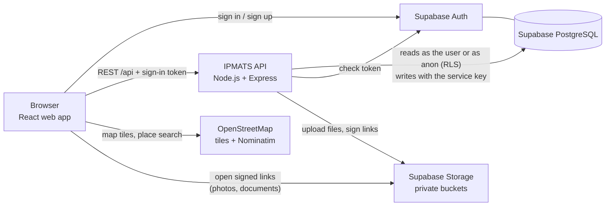

# Technology stack

What the system is built with, the version in use, and why. Versions come from `client/package.json`,
`server/package.json` and their lock files.

- **Declared:** the version (or range, such as `^4.21.1`) written in `package.json`.
- **Installed:** the exact version in `package-lock.json`, which is what `npm install` gives you. The two differ
  only where `package.json` uses a range.

## Architecture

- The browser talks to Supabase directly **only for authentication** (sign-in, sign-up, session, password change).
  All data goes through the API.
- The API checks every request (see [roles-and-permissions.md](roles-and-permissions.md#how-access-is-enforced)).
  It reads with the caller's own token, or as the anonymous role for the public portal, so Row Level Security
  applies. It writes with the service-role key, which only the server has.
- Files live in private Storage buckets. The browser gets only short-lived signed links from the API.
- In development, Vite forwards `/api` to the API on port 4000. With Docker, nginx serves the built web app and
  forwards `/api` to the API container.

## Frontend

| Part | Package | Declared | Installed | Why it is used here |
|---|---|---|---|---|
| Framework | react, react-dom | 18.3.1 | 18.3.1 | Builds the user interface out of reusable components |
| Language | JavaScript (ES modules, JSX) | — | — | No TypeScript in the project |
| Build tool | vite | 5.4.11 | 5.4.11 | Fast development server and production build; separate bundles for map, charts and Supabase |
| React plugin | @vitejs/plugin-react | 4.3.3 | 4.3.3 | JSX support in Vite |
| Routing | react-router-dom | 6.28.0 | 6.28.0 | Pages, the staff route guards, lazy-loaded pages, the `?project=` drawer address |
| Styling | tailwindcss | 3.4.15 | 3.4.15 | Utility CSS classes; colours and animations defined in `tailwind.config.js` |
| CSS processing | postcss, autoprefixer | 8.4.49, 10.4.20 | same | Runs Tailwind and adds browser prefixes |
| State | React context and hooks | — | — | `AuthContext` (session, profile, role), `ToastContext`, a small `useApi` fetch hook; filters kept in the URL. No Redux or other state library |
| Accessible UI parts | @headlessui/react | 2.2.0 | 2.2.0 | Keyboard-accessible dropdowns (searchable selects, account menu, date-picker pop-up) |
| Icons | lucide-react | 0.460.0 | 0.460.0 | One consistent icon set |
| Font | @fontsource/public-sans | 5.1.0 | 5.1.0 | Public Sans, self-hosted (no Google Fonts call); licence OFL-1.1 |
| Date picker | react-day-picker | 9.4.4 | 9.4.4 | Date fields in the forms |
| Charts | chart.js, react-chartjs-2 | ^4.4.6, ^5.2.0 | 4.4.6, 5.2.0 | Dashboard charts (flags, status, progress, money) |
| Supabase client | @supabase/supabase-js | 2.45.4 | 2.45.4 | Sign-in, sign-up and the session token sent to the API |

## Mapping and 360°

| Part | Package / source | Declared | Installed | Licence | Why it is used here |
|---|---|---|---|---|---|
| Map library | leaflet | ^1.9.4 | 1.9.4 | BSD-2-Clause | Interactive maps (public map, staff map, location picker) |
| React binding | react-leaflet | ^4.2.1 | 4.2.1 | Hippocratic-2.1 (as listed in the lock file) | Leaflet as React components |
| 360° viewer | pannellum | ^2.5.6 | 2.5.6 | MIT | Shows equirectangular 360° photos in the browser |
| Map tiles | OpenStreetMap standard tiles (`tile.openstreetmap.org`) | — | — | Map data © OpenStreetMap contributors, ODbL; use is subject to the OSM tile usage policy | Free street map, no API key |
| Place search | OpenStreetMap Nominatim (`nominatim.openstreetmap.org`) | — | — | Nominatim usage policy | "Search a place" in the project location picker, only when the user searches |
| Province boundary | `occidental-mindoro.json` (OSM relation 1506320) | — | — | © OpenStreetMap contributors, ODbL 1.0 | Refuses project locations outside Occidental Mindoro (browser and API keep identical copies) |
| 360° imagery | Photos uploaded by DPWH personnel | — | — | Owned by the uploaders | The only image source. The app uses no Google Street View or other third-party imagery |

## Backend

| Part | Package | Declared | Installed | Why it is used here |
|---|---|---|---|---|
| Runtime | Node.js | `>=22` (engines); Docker image `node:22-slim` | — | JavaScript on the server; built-in test runner and `--env-file` |
| Framework | express | ^4.21.1 | 4.22.3 | HTTP server and routing |
| API style | REST + JSON under `/api` | — | — | Simple resource URLs (`/projects/:id/phases`…); file downloads for reports |
| Supabase client | @supabase/supabase-js | ^2.45.4 | 2.119.0 | Talks to Auth, the database and Storage |
| Validation | zod | ^3.23.8 | 3.25.76 | Checks every request body before it reaches the database |
| Security headers | helmet | ^8.0.0 | 8.3.0 | Standard HTTP security headers |
| CORS | cors | ^2.8.5 | 2.8.6 | Lets only the configured web-app origins call the API |
| Rate limit | express-rate-limit | ^7.4.1 | 7.5.1 | Four limiters (`middleware/rateLimits.js`): 600/min per IP before sign-in, 300/min per account, 20 uploads and 30 report downloads per 10 min per account. The client IP depends on `TRUST_PROXY` (proxy hop count) |
| File uploads | multer | ^1.4.5-lts.1 | 1.4.5-lts.2 | Receives photos, evidence and documents in memory, with size and type limits |
| Image processing | sharp | 0.35.5 | 0.35.5 | Reads width and height (2:1 panorama check); stores a smaller copy of very large panoramas; profile photos; perceptual hash for near-duplicate detection. Pinned exactly; upgraded from 0.33.5 for libvips security fixes |
| Image file check | own code (`services/imageFormat.js`) | — | — | Checks the first bytes of every uploaded image so only real JPEG, PNG or WebP files reach sharp and exifr |
| Photo similarity | own code (`services/perceptualHash.js`) | — | — | 64-bit difference hash (dHash) of each 360° photo, compared by Hamming distance (≤ 6 bits = near-duplicate) |
| Photo metadata | exifr | ^7.1.3 | 7.1.3 | Reads GPS and capture time from photos |
| PDF reports | pdfkit | ^0.15.2 | 0.15.2 | Builds the audit reports |
| Excel reports | exceljs | ^4.4.0 | 4.4.0 | Builds formatted .xlsx files |
| Scheduler | node-cron | ^3.0.3 | 3.0.3 | Daily flag check at 01:15, Asia/Manila |
| Configuration | dotenv | ^16.4.5 | 16.6.1 | Loads `server/.env` |

## Database and hosting

| Part | What | Why |
|---|---|---|
| Engine | PostgreSQL 17 (live server reports 17.11) | Relational data, constraints, triggers, Row Level Security |
| Hosting | Supabase (project IPMATS) | Managed Postgres with Auth and Storage in one place |
| Authentication | Supabase Auth, email and password | Sign-in, sign-up, password change, account bans (suspension) |
| File storage | Supabase Storage, 4 private buckets | Photos, evidence, documents, profile photos |
| Production hosting | Web app on Vercel; Vercel forwards `/api/*` to the API on Render (`client/vercel.json`) | Two proxies sit in front of the API, so `TRUST_PROXY` must match the hop count for rate limits to see the real client IP (verify with `DEBUG_PROXY=1`) |
| Deployment (optional) | Docker: `server/Dockerfile` (node:22-slim), `client/Dockerfile` (build on node:22-slim, served by nginx:1.27-alpine), `docker-compose.yml` | Runs the API and web app with one command |

Details of the schema: [database.md](database.md).

## Development tooling

| Part | What | Version | Notes |
|---|---|---|---|
| Package manager | npm | — | `package-lock.json` in `client/` and `server/`; root scripts `install:all`, `dev:server`, `dev:client`, `test`, `build` |
| Client tests | vitest | 2.1.5 | `npm test` in `client/`, Node environment |
| Server tests | Node.js built-in test runner (`node --test`) | — | `npm test` in `server/` |
| HTTP tests | supertest | ^7.0.0 (installed 7.3.2) | Calls the Express app in the server tests |
| Sample photos | piexifjs | ^1.0.6 (installed 1.0.6) | Writes GPS / time into the generated sample panoramas (`server/scripts/panorama.mjs`, used by `npm run seed:images`) |
| Linting | **None configured** | — | No ESLint config or dependency in the repository. A few `eslint-disable` comments remain in the code |
| Formatting | **None configured** | — | No Prettier or EditorConfig file |
